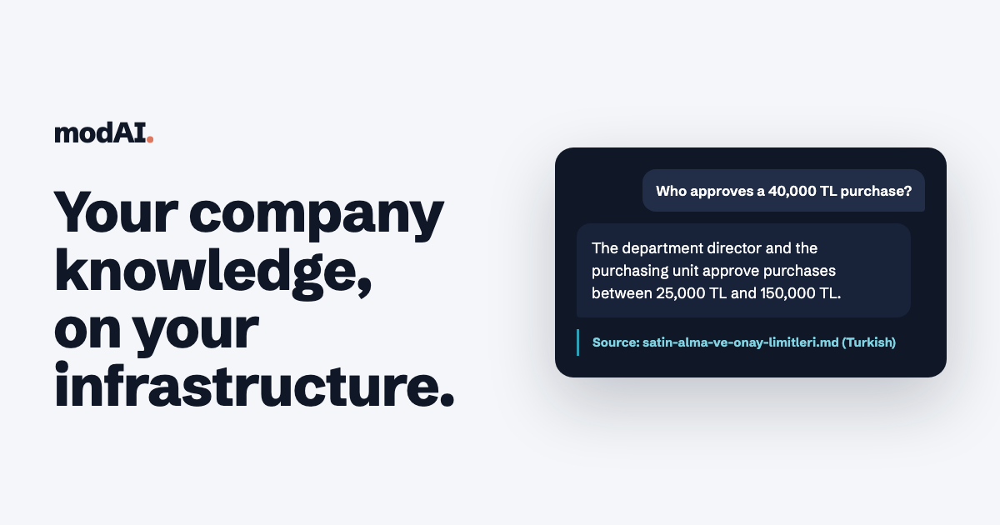

# modAI — Your company knowledge, on your own infrastructure.

**modAI** is an AI assistant that answers from your company's documents and starts the work with approval steps. It runs on your own server or on the pre-installed modAI Box, shows the document behind every answer and does not make up what the documents do not say.

[Website](https://wearetheartmakers.github.io/modAI-stack/en/) · [Türkçe](README.md) · [How to buy](#order-today-running-today) · [Pricing](#pricing) · **info@wearetheartmakers.com** · +90 505 314 9360

> This repository is modAI's product page; it contains no source code. modAI is proprietary software by WATAM, licensed for use.

## Why modAI?

| | |
|---|---|
| **Inside your company, offline** | Documents, search index, language model and voice models stay on your machine. Installation, upgrades and the licence check work without the internet. |
| **It does not just find the answer; it starts the work** | An employee writes "I'd like three days of annual leave from next Monday"; modAI offers the leave request and fills in the form from that sentence. The approver sees the figures computed from the request next to the policy's own sentences, and for purchases the approval limit the amount falls into is highlighted. Four-eyes rule, delegation and reminders are built in. After the last approval the request goes to your HR or ERP system, signed. |
| **Shows its source, does not invent** | The document, section and quote behind each answer sit next to it. If no document covers the question, modAI says so; the question goes to the unanswered-questions report so the missing document becomes visible. |
| **Multilingual** | Ask in English and modAI finds the answer in Turkish documents too, and replies in the language of the question. Turkish speech recognition and a Turkish neural voice. The console is in Turkish today. |
| **Enterprise identity** | Active Directory, Microsoft Entra ID, Okta and Google sign-in; SCIM provisioning. File-server and SharePoint permissions travel with the documents. |
| **Quality is measured** | Acceptance questions and hidden-instruction security tests run again whenever the model changes. An assurance report (PDF) goes into your purchasing file. |
| **Data protection tools** | Data inventory, retention periods, personal data export and erasure. |
| **Fixed annual price** | No monthly fee per user. A Business licence for a 250-person company costs €9,900 per year. |

## Order today, running today

1. **20-minute demo**, live or on video.
2. **Pilot order**: a one-page order form, signed electronically; payment by bank transfer.
3. **Licence key and installation package the same day.** Or the modAI Box arrives installed.
4. **One-hour setup session.** The package installs offline; the key is pasted into the Licence screen.
5. **Annual licence:** paste the new key; no reinstallation. The pilot fee is credited against the first year.

Invoices in euros; outside Turkey, payment by bank transfer (SWIFT).

## Pricing

| Plan | Price | Scope |
|---|---|---|
| **Pilot** | €2,900 one-time | 30-day licence, 25 users, setup and acceptance test. Credited against the first annual licence. |
| **Business** | €9,900 / year | Up to 250 users, production installation on your server, voice assistant, approved requests, support and upgrades. |
| **Enterprise** | from €19,900 / year | Users by contract, multi-team rollout, standby machine, custom integration, priority support. |

Prices exclude taxes and hardware. [Commercial licensing](COMMERCIAL_LICENSING.md)

## Documents (Turkish)

- [User guide](docs/guides/kurumsal-kullanim-kilavuzu.md)
- [Security architecture](docs/guides/guvenlik-mimarisi.md)
- [Capacity and hardware](docs/guides/kapasite-ve-donanim.md)
- [Installation and delivery guide](docs/guides/kurulum-ve-teslim-rehberi.md)
- [Support and update policy](docs/guides/destek-ve-guncelleme-politikasi.md)
- [Licensing and third-party components](docs/guides/lisanslama.md)
- [Release notes](CHANGELOG.md)

## Contact

Sales and support: **info@wearetheartmakers.com**, **+90 505 314 9360**. Security reports: **admin@wearetheartmakers.com** ([security policy](SECURITY.md)).

© 2026 WATAM — We Are The Art Makers. All rights reserved.
