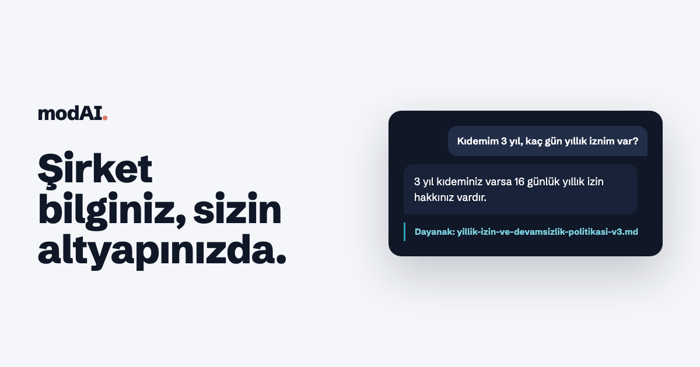
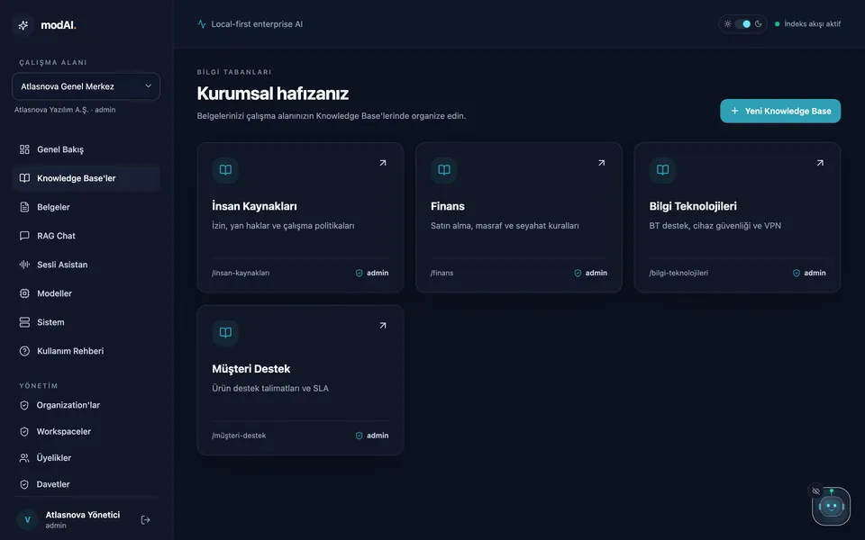
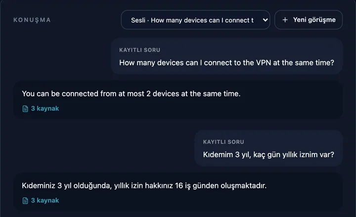

# modAI — Şirket bilginiz, sizin altyapınızda.

**modAI**, şirket belgelerinizden yanıt veren ve işi onaylı adımlarla başlatan bir yapay zekâ asistanıdır. Kendi sunucunuzda ya da kurulu gelen modAI Kutusu'nda çalışır; her yanıtı dayandığı belgeyle gösterir, belgede olmayanı uydurmaz. Türkçe ve sesli.

[Tanıtım sitesi](https://wearetheartmakers.github.io/modAI-stack/) · [English](README.en.md) · [Satın alma](#bugün-sipariş-bugün-kurulum) · [Fiyatlar](#fiyatlar) · **info@wearetheartmakers.com** · +90 505 314 9360

> Bu depo modAI'nin tanıtım sayfasıdır; yazılımın kaynak kodunu içermez. modAI, WATAM'ın tescilli ürünüdür ve lisansla kullanılır.

## Neden modAI?

| | |
|---|---|
| **Şirketin içinde, internetsiz** | Belgeler, arama dizini, dil modeli ve ses modelleri şirketinizin makinesindedir. Kurulum, güncelleme ve lisans doğrulaması internete çıkmadan yapılır. |
| **Bilgiyi bulmakla kalmaz, işi başlatır** | "Gelecek pazartesiden itibaren 3 gün izin almak istiyorum" yazan çalışana izin talebini önerir ve formu cümlesinden doldurur. Onaycı, talepten hesaplanan sayıları politikanın kendi cümlesinin yanında görür. Satın almada tutarın girdiği onay limiti vurgulanır. Dört göz kuralı, vekâlet ve hatırlatma vardır. Son onaydan sonra talep İK ya da ERP sisteminize imzalı olarak gider. |
| **Kaynak gösterir, uydurmaz** | Yanıtın dayandığı belge, bölüm ve alıntı yanıtın yanındadır. Soruyu karşılayan belge yoksa modAI tahmin yürütmez; soru "yanıtlanamayan sorular" raporuna düşer ve eksik belge görünür olur. |
| **Türkçe, İngilizce ve sesli** | Konsol Türkçe ve İngilizce; her kullanıcı dilini seçer. Türkçe nöral ses ve sunucuda Türkçe konuşma tanıma. "Kırk bin lira" ya da "gelecek pazartesi" gibi ifadeler doğru okunur. Türkçe soru İngilizce belgede de bulunur. |
| **Kurumsal kimlik** | Active Directory, Microsoft Entra ID, Okta ve Google ile giriş; SCIM ile hesap açma-kapatma. Dosya sunucusu ve SharePoint izinleri belgeyle birlikte gelir. |
| **Kalite sayıyla ölçülür** | Kabul soruları ve gizli talimat güvenlik testleri her model değişikliğinde yeniden çalışır. Güven raporu (PDF) satın alma dosyanıza eklenir. |
| **KVKK araçları** | Veri envanteri, saklama süreleri, kişisel veri dökümü ve silme. |
| **Sabit yıllık fiyat** | Kullanıcı başı aylık ücret yok. 250 kişilik bir şirket için Business lisansı yıllık 9.900 €. |

<table>
  <tr>
    <td width="50%"> <strong>Departman başına bilgi tabanı.</strong> Herkes yalnızca yetkili olduğu yerde arar.</td>
    <td width="50%"> <strong>Yazarak ya da sesle.</strong> Yanıt, dayandığı kaynaklarla gelir.</td>
  </tr>
</table>

## Bugün sipariş, bugün kurulum

1. **20 dakikalık demo**: canlı ya da video.
2. **Pilot siparişi**: tek sayfalık sipariş formu, e-imza. Ödeme havale ya da kartla.
3. **Aynı gün lisans anahtarı ve kurulum paketi.** İsterseniz modAI Kutusu kurulu gelir.
4. **Bir saatlik kurulum oturumu.** Paket internetsiz kurulur; anahtar Lisans ekranına yapıştırılır.
5. **Yıllık lisans:** yeni anahtar yapıştırılır, yeniden kurulum gerekmez. Pilot bedeli ilk yıl lisansından düşülür.

**Türkiye:** fiyat Euro; fatura TL olarak, fatura günündeki TCMB döviz satış kuruyla kesilir (e-Fatura). **Yurt dışı:** Euro fatura, banka havalesi (SWIFT).

## Fiyatlar

| Paket | Fiyat | Kapsam |
|---|---|---|
| **Pilot** | 2.900 € tek seferlik | 30 günlük lisans, 25 kullanıcı, kurulum ve kabul testi. Bedeli ilk yıl lisansından düşülür. |
| **Business** | 9.900 € / yıl | 250 kullanıcıya kadar, kendi sunucunuzda üretim kurulumu, sesli asistan, onaylı talepler, destek ve güncellemeler. |
| **Enterprise** | 19.900 € / yıl'dan | Kullanıcı sayısı sözleşmeye göre, çok ekipli kurulum, yedek makine, özel entegrasyon, öncelikli destek. |

Fiyatlara vergiler ve donanım dahil değildir. [Ticari lisans koşulları](COMMERCIAL_LICENSING.md)

## Belgeler

- [Kurumsal kullanım kılavuzu](docs/guides/kurumsal-kullanim-kilavuzu.md)
- [Güvenlik mimarisi](docs/guides/guvenlik-mimarisi.md)
- [KVKK veri envanteri](docs/guides/kvkk-veri-envanteri.md)
- [Kapasite ve donanım](docs/guides/kapasite-ve-donanim.md)
- [Kurulum ve teslim rehberi](docs/guides/kurulum-ve-teslim-rehberi.md)
- [Destek ve güncelleme politikası](docs/guides/destek-ve-guncelleme-politikasi.md)
- [Lisanslama ve üçüncü taraf bileşenler](docs/guides/lisanslama.md)
- [Sürüm notları](CHANGELOG.md)

## İletişim

Satış ve destek: **info@wearetheartmakers.com**, **+90 505 314 9360**. Güvenlik bildirimleri: **admin@wearetheartmakers.com** ([güvenlik politikası](SECURITY.md)).

© 2026 WATAM — We Are The Art Makers. Tüm hakları saklıdır.
